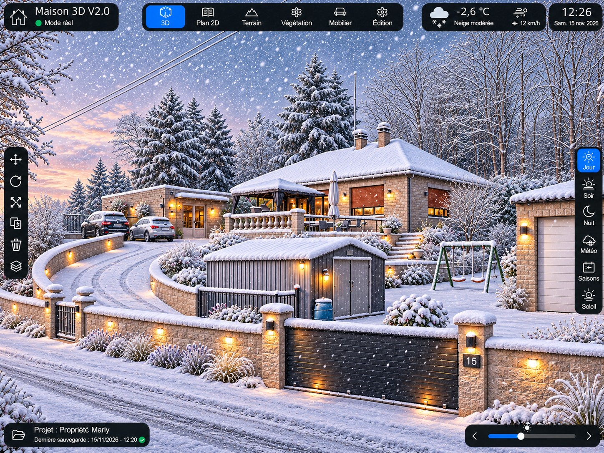

<div align="center">
  

# 🏡 Maison 3D

**Votre propriété animée dans Home Assistant · Photographies météo · Saisons · Lune · Vue 3D**

[](https://github.com/XAV59213/maison3d/releases/latest)
[](https://github.com/XAV59213/maison3d/actions/workflows/validate.yml)
[](https://www.home-assistant.io/)
[](https://www.hacs.xyz/)


*Image officielle de référence, validée par le propriétaire : maison au centre, rampe et voitures à gauche, abri métallique au premier plan, garage et jardin à droite.*

[**Installation**](#-installation-avec-hacs) · [**Galerie météo**](#-galerie-des-vraies-photos-météo) · [**Carte Lovelace**](#-carte-lovelace-prête-à-lemploi) · [**Capteurs**](#-configurer-les-capteurs-home-assistant) · [**Tests des effets**](#-tester-tous-les-états)

</div>

---

## ✨ Présentation

**Maison 3D** est une **intégration Home Assistant** installable via HACS, en catégorie **Intégration** et non en catégorie « Carte / Dashboard ».

Elle propose deux vues complémentaires :

| Vue | Description |
|:--|:--|
| 🖼️ **Photo réelle animée** | Photographies de la propriété et effets météo superposés : pluie, neige, nuages, soleil, vent, orages et saisons |
| 🏡 **Scène Three.js** | Maquette géométrique indépendante en 3D avec zoom, rotation, vues caméra et édition d'objets |

**À savoir :** une photo est une image fixe enrichie d'animations ; ce n'est pas un modèle 3D rotatif. La maquette Three.js reste distincte et ne reproduit pas encore exactement la photographie officielle.

### Fonctionnalités

- 🌤️ Ambiance selon l'entité météo et le soleil de Home Assistant.
- 🌓 **Lune dessinée directement dans le ciel**, y compris en journée lorsque sa phase est disponible, avec huit formes lunaires.
- ☀️ Commandes **Jour**, **Nuit réelle** et **Auto** : changement immédiat de l'ambiance photographique.
- 🌧️ Gouttes de pluie et reflets graphiques ; ❄️ flocons et voile hivernal.
- ⚡ Éclairs visibles en mode orage ; 💨 rafales de vent ; ☁️ nuages mobiles.
- 🌸 Pétales de printemps, ☀️ rayons d'été, 🍂 feuilles d'automne, ❄️ chute de neige hivernale.
- 🎚️ Intensité des animations de **0 à 200 %**.
- 🎮 **Prévisualisation manuelle de chaque état**, sans modifier les entités Home Assistant.
- 🩺 Sélection de capteurs et état de disponibilité depuis l'intégration.
- 🎨 **19 emplacements d'images configurables** pour les météos, saisons et phases lunaires.

## 📸 Galerie des vraies photos météo

Les quatre fichiers ci-dessous sont **inclus dans le dépôt** et sont distribués par l'intégration depuis la version **v2.3.1**. Aucun chargement manuel dans `/config/www` n'est nécessaire pour ces images.

<table>
<tr>
<td align="center" width="50%">
  <strong>☀️ Jour ensoleillé</strong><br/>
  <br/>
  <sub>jour.jpg</sub>
</td>
<td align="center" width="50%">
  <strong>☁️ Ciel nuageux</strong><br/>
  <br/>
  <sub>nuageux.jpg</sub>
</td>
</tr>
<tr>
<td align="center">
  <strong>🌧️ Pluie</strong><br/>
  <br/>
  <sub>pluie.jpg</sub>
</td>
<td align="center">
  <strong>❄️ Neige</strong><br/>
  <br/>
  <sub>neige.jpg</sub>
</td>
</tr>
</table>

Les images sont accessibles depuis le navigateur connecté à Home Assistant :

| Ambiance | URL d'image installée |
|---|---|
| ☀️ Jour | `/maison3d-assets/images/jour.jpg` |
| ☁️ Nuageux | `/maison3d-assets/images/nuageux.jpg` |
| 🌧️ Pluie | `/maison3d-assets/images/pluie.jpg` |
| ❄️ Neige | `/maison3d-assets/images/neige.jpg` |

**Autres ambiances :** le dépôt ne livre pas encore de JPEG distinct pour Nuit, Vent, Orage, chaque saison ou chaque phase lunaire. Le logiciel utilise alors la photo de référence et les effets animés, ou une image personnalisée si vous l'avez configurée.

## 📦 Installation avec HACS

1. Ouvrir **HACS → Dépôts personnalisés**.
2. Ajouter : **`https://github.com/XAV59213/maison3d`**.
3. Choisir la catégorie **Intégration**.
4. Installer Maison 3D puis **redémarrer Home Assistant**.
5. Aller dans **Paramètres → Appareils et services → Ajouter une intégration** et chercher **Maison 3D**.
6. Ouvrir le panneau **Maison 3D** dans la barre latérale.

**Version de cette PR : v2.3.3** (publication après fusion et validation). [Releases officielles](https://github.com/XAV59213/maison3d/releases).

<details>
<summary>Installation manuelle</summary>

Copier le dossier `custom_components/maison3d` vers `/config/custom_components/maison3d`, redémarrer Home Assistant, puis ajouter l'intégration. Le dossier `www/images` fait partie de l'intégration.

</details>

## 🌡️ Configurer les capteurs Home Assistant

Aller dans **Paramètres → Appareils et services → Maison 3D → Configurer**.

| Capteur | Domaine Home Assistant | Utilisation |
|---|---|---|
| 🌤️ Météo | `weather.*` | Condition actuelle |
| ☀️ Soleil | `sun.sun` | Jour et nuit |
| 🌙 Phase lunaire | `sensor.*` | Forme de la lune dessinée sur la photo |
| 🌡️ Température | `sensor.*` | Relevé extérieur |
| 💨 Vent | `sensor.*` | Rafales / mouvement |
| 🌧️ Pluie | `sensor.*` / `binary_sensor.*` | Pluie active |
| ❄️ Neige | `sensor.*` / `binary_sensor.*` | Neige active |
| ☁️ Nuages | `sensor.*` / `binary_sensor.*` | Couverture nuageuse |

Tous les capteurs supplémentaires sont facultatifs. La météo et le soleil peuvent fournir les données de base ; les autres valeurs enrichissent l'animation.

La page de l'appareil Maison 3D propose **un diagnostic général et des diagnostics individuels** : `OK`, `Non configuré`, `Introuvable`, `Indisponible`. Ils vérifient la disponibilité des entités, pas l'exactitude météorologique d'une mesure.

## 🖥️ Carte Lovelace prête à l'emploi

Après installation de l'intégration, ajouter la ressource **Module JavaScript** :

```text
/maison3d-assets/maison3d-card.js
```

Puis ajouter une carte manuelle :

```yaml
type: custom:maison3d-card
title: Maison 3D
height: 600
```

Les capteurs sélectionnés dans l'intégration sont repris automatiquement si la carte ne définit pas de remplacement. L'éditeur visuel de la carte permet de choisir ses propres capteurs et les images de chaque état.

<details>
<summary>Exemple avancé : carte personnalisée</summary>

```yaml
type: custom:maison3d-card
title: Ma propriété
height: 600
weather_entity: weather.maison
sun_entity: sun.sun
moon_entity: sensor.moon_phase
temperature_entity: sensor.temperature_exterieure
wind_entity: sensor.vitesse_vent
rain_entity: binary_sensor.pluie
snow_entity: binary_sensor.neige
cloud_entity: sensor.couverture_nuageuse
images:
  night: /local/maison3d/nuit.jpg
  storm: /local/maison3d/orage.jpg
  wind: /local/maison3d/vent.jpg
  moon_full_moon: /local/maison3d/pleine_lune.jpg
```

**Exemple à adapter** : ces noms d'entités ne sont pas garantis sur votre installation. Les images sous `/local/maison3d/` doivent être placées dans `/config/www/maison3d/`.

</details>

## 🎮 Tester tous les états

Le panneau **⚙ Images / météo** contient une zone **« Tester chaque état »** qui sert à vérifier les effets **sans modifier les vrais capteurs**.

| Test | Effet attendu |
|---|---|
| ☀ Jour | Photo lumineuse / soleil |
| ☾ Nuit | Assombrissement de la photo |
| ☁ Nuages | Photo nuageuse et voile mobile |
| 🌧 Pluie | Gouttes et reflets visuels |
| ❄ Neige | Flocons et atmosphère hivernale |
| 💨 Vent | Rafales et feuilles en mouvement |
| ⚡ Orage | Pluie et éclairs dessinés |
| 🌸 Printemps | Pétales flottants |
| ☀ Été | Rayons de soleil |
| 🍂 Automne | Feuilles emportées |
| ❄ Hiver | Neige et voile froid |

**Phases lunaires :** un sélecteur permet de tester **nouvelle lune**, **premier croissant**, **premier quartier**, **gibbeuse croissante**, **pleine lune**, **gibbeuse décroissante**, **dernier quartier** et **dernier croissant**. La lune apparaît **sur l'image même en journée**. En mode normal, sa phase provient du capteur Home Assistant configuré, s'il est disponible et reconnu.

À droite de la vue photo, les boutons **Printemps, Été, Automne, Hiver et Saisons auto** donnent aussi un accès direct aux démonstrations saisonnières.

Pour retourner aux conditions réelles, utiliser **◉ Revenir à la météo réelle** dans le panneau de test ou **◉ Auto** dans la barre supérieure.

> Les boutons de test sont un **aperçu manuel local**, et ne modifient ni la météo ni le capteur lunaire dans Home Assistant.

## 🌙 Lune, saisons et météo animée

Le module dessine la lune comme un disque lumineux dans le ciel, avec masque de phase, relief discret et halo. En journée, le halo est plus faible ; la lune reste visible tant qu'une phase valide est connue. Si le capteur de phase est absent, on peut tester manuellement les huit phases, mais le programme ne doit pas présenter une phase simulée comme une donnée astronomique réelle.

Les animations météo sont **des effets visuels superposés à une photographie** : pluie, neige, reflets doux, brume, rafales, éclairs, rayons solaires et feuilles. Leur intensité est réglable de **0 à 200 %** et peut être désactivée.

Les saisons suivent le calendrier local en mode Auto ; les boutons de droite permettent de les forcer pour un aperçu. Une vraie photo enneigée présente de la neige sur les éléments de la propriété ; un simple filtre animé ne remplace pas une photographie d'hiver.

## 🎨 Personnaliser les images

**19 images peuvent être remplacées** :

- **Météo et saisons (11)** : `day`, `night`, `cloudy`, `rain`, `snow`, `wind`, `storm`, `spring`, `summer`, `autumn`, `winter`.
- **Phases lunaires (8)** : `moon_new_moon`, `moon_waxing_crescent`, `moon_first_quarter`, `moon_waxing_gibbous`, `moon_full_moon`, `moon_waning_gibbous`, `moon_last_quarter`, `moon_waning_crescent`.

Pour utiliser une photo personnelle :

1. La déposer dans `/config/www/maison3d/`.
2. Saisir son URL (exemple `/local/maison3d/nuit.jpg`) dans le champ correspondant de la carte ou du panneau.
3. Choisir **Tester** pour vérifier le résultat.

Les quatre photos météo installées avec HACS restent disponibles automatiquement sans configuration. Les réglages du panneau Photo sont enregistrés dans le **navigateur local** ; pour reproduire une configuration sur plusieurs appareils, préférer les options de l'intégration et la configuration YAML de la carte.

## 🏗️ Vue 3D et édition

La scène Three.js distincte propose les vues **Façade, Aérienne, Jardin et Garage**, ainsi que la rotation, le zoom, le déplacement et le redimensionnement des objets. Dans le panneau complet, elle permet également l'**export et l'import JSON**.

La géométrie 3D est approximative et ne doit pas être présentée comme la vraie photographie en volume. Le stockage de la scène s'effectue dans le navigateur ; exporter le JSON pour conserver une sauvegarde.

## 🛠️ Dépannage

<details>
<summary>Maison 3D ne s'affiche pas</summary>

Vérifier que l'intégration a été ajoutée après l'installation HACS, puis **redémarrer Home Assistant**. Actualiser le navigateur (Ctrl + F5). Contrôler la ressource `/maison3d-assets/maison3d-card.js` et tester `/maison3d-assets/index.html`. La vue 3D dépend de Three.js chargé depuis un CDN ; vérifier la connexion réseau si elle reste vide.

</details>

<details>
<summary>La météo ou la lune ne change pas</summary>

Dans **Paramètres → Appareils et services → Maison 3D → Configurer**, vérifier l'identifiant des entités, puis leur état dans **Outils de développement → États**. Éviter `unknown` ou `unavailable`. Quitter le mode Test et réactiver **◉ Auto**.

</details>

<details>
<summary>Le bouton « Nuit réelle » n'a pas d'effet</summary>

La correction de la commande Nuit réelle est incluse dans **v2.3.2**. Vérifier la version installée avec HACS, redémarrer Home Assistant, vider le cache navigateur si nécessaire. La photo doit s'assombrir, même sans fichier de nuit personnalisé.

</details>

<details>
<summary>Une image personnalisée est inaccessible</summary>

Tester l'URL directement depuis Home Assistant. Exemple : `/config/www/maison3d/nuit.jpg` devient `/local/maison3d/nuit.jpg`. Une erreur de nom de fichier ou d'autorisation peut empêcher l'affichage.

</details>

## 🔗 Liens utiles

- [Dépôt GitHub](https://github.com/XAV59213/maison3d)
- [Releases officielles](https://github.com/XAV59213/maison3d/releases)
- [Actions — Validation HACS, Hassfest et tests](https://github.com/XAV59213/maison3d/actions/workflows/validate.yml)
- [Signaler un problème ou proposer une idée](https://github.com/XAV59213/maison3d/issues)

---

<div align="center">

**Maison 3D · Home Assistant · © XAV59213**

*Intégration communautaire non officielle. Les tests automatiques ne remplacent pas un essai visuel sur une instance Home Assistant réelle.*

</div>
