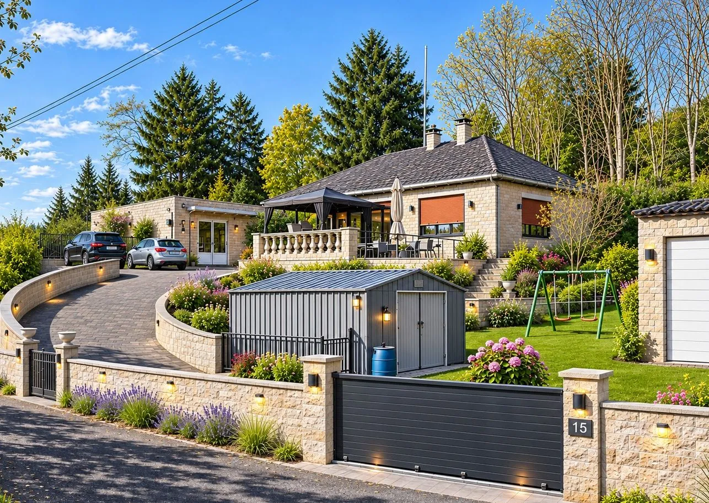
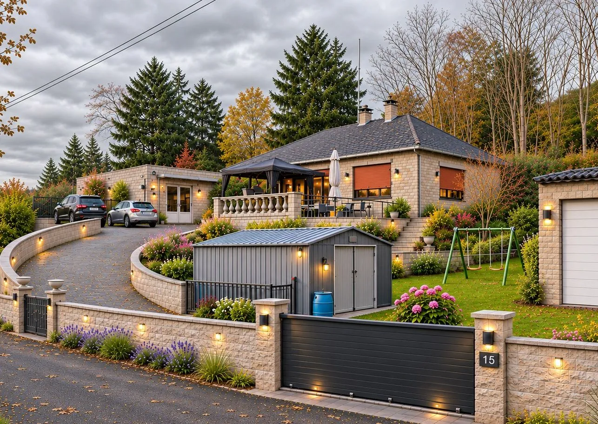
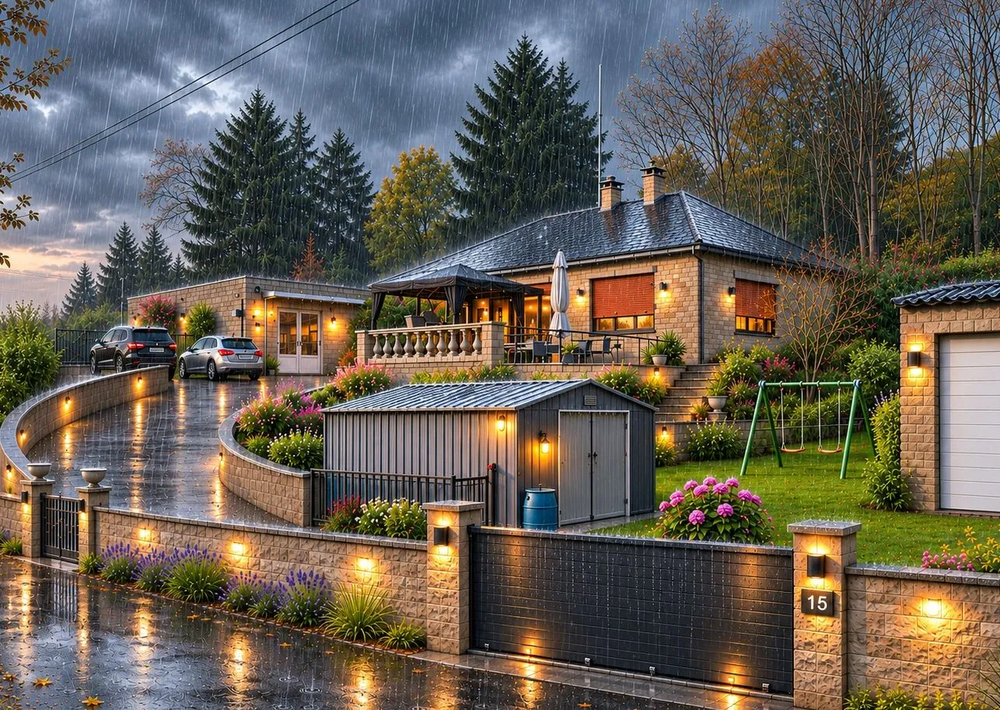
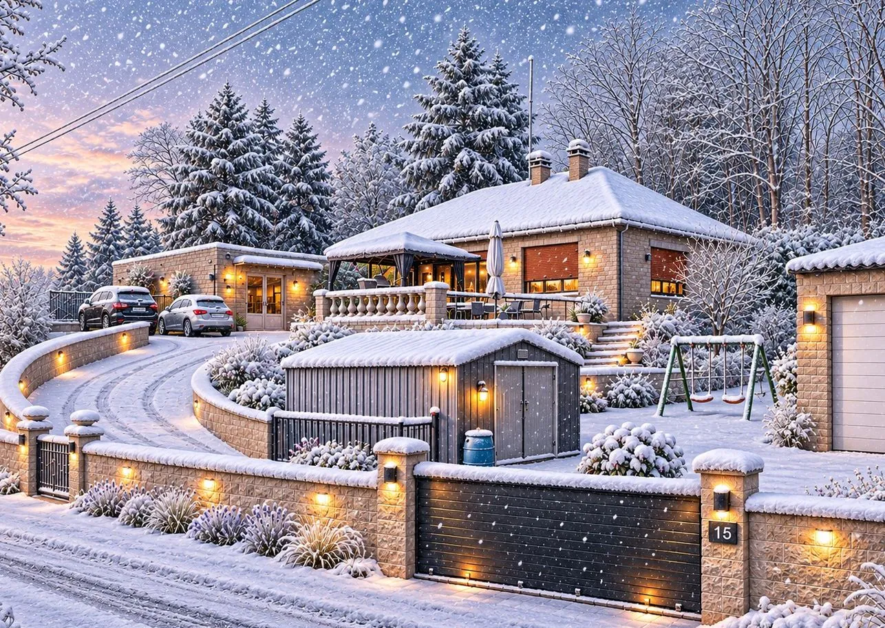

<div align="center">
  

# 🏡 Maison 3D

**Votre propriété animée dans Home Assistant · Photographies météo · Saisons · Lune · Vue 3D**

[](https://github.com/XAV59213/maison3d/releases/latest)
[](https://github.com/XAV59213/maison3d/actions/workflows/validate.yml)
[](https://www.home-assistant.io/)
[](https://www.hacs.xyz/)


*Image officielle de référence, validée par le propriétaire : maison au centre, rampe et voitures à gauche, abri métallique au premier plan, garage et jardin à droite.*

[**Installation**](#-installation-avec-hacs) · [**Photos météo**](#-photos-météo-jour--nuit) · [**Carte Lovelace**](#-carte-lovelace-prête-à-lemploi) · [**Capteurs**](#-configurer-les-capteurs-home-assistant) · [**Mode test**](#-mode-test)

</div>

---

## ✨ Présentation

**Maison 3D** est une **intégration Home Assistant** installable via HACS, en catégorie **Intégration** et non en catégorie « Carte / Dashboard ».

Elle propose deux vues complémentaires :

| Vue | Description |
|:--|:--|
| 🖼️ **Photo réelle animée** | Photographies de la propriété et effets météo superposés : pluie, neige, nuages, soleil, vent, orages et saisons |
| 🏡 **Scène Three.js** | Maquette géométrique indépendante en 3D avec zoom, rotation, vues caméra et édition d'objets |

**À savoir :** une photo est une image fixe enrichie d'animations ; ce n'est pas un modèle 3D rotatif. La maquette Three.js reste distincte et ne reproduit pas encore exactement la photographie officielle.

### Fonctionnalités

- 🌤️ Ambiance selon l'entité météo et le soleil de Home Assistant.
- 🌓 **Lune dessinée directement dans le ciel**, y compris en journée lorsque sa phase est disponible, avec huit formes lunaires.
- ☀️ Commandes **Jour**, **Nuit réelle** et **Auto** : changement immédiat de l'ambiance photographique.
- 🌧️ Gouttes de pluie et reflets graphiques ; ❄️ flocons et voile hivernal.
- ⚡ Éclairs visibles en mode orage ; 💨 rafales de vent ; ☁️ nuages mobiles.
- 🌸 Pétales de printemps, ☀️ rayons d'été, 🍂 feuilles d'automne, ❄️ chute de neige hivernale.
- 🎚️ Intensité des animations de **0 à 200 %**.
- 🎮 **Prévisualisation manuelle de chaque état**, sans modifier les entités Home Assistant.
- 🩺 Sélection de capteurs et état de disponibilité depuis l'intégration.
- 🎨 **19 emplacements d'images configurables** pour les météos, saisons et phases lunaires.

## 🖼️ Choisir sa propre photo — v2.3.6

Chaque utilisateur peut désormais utiliser **sa propre photographie de maison** comme arrière-plan fixe, avec toutes les animations Home Assistant au-dessus. L'image officielle livrée est utilisée si aucune image n'est renseignée ou si l'URL choisie est inaccessible.

**Exemple :** déposez `ma-maison.jpg` dans `/config/www/maison3d/`, puis renseignez `/local/maison3d/ma-maison.jpg`.

- **Configuration globale :** Paramètres → Appareils et services → **Maison 3D** → **Configurer** → **Image principale**. Le choix s'applique au panneau Maison 3D et aux cartes qui ne définissent pas leur propre photo.
- **Configuration par carte Lovelace :** éditeur visuel de la carte → **Image principale de la propriété** → URL personnalisée et **Vérifier et prévisualiser**. La carte a priorité sur la configuration globale.
- **Panneau photo :** bouton **⚙ Images / météo** → **Image principale personnalisée**, avec bouton de contrôle et aperçu. Ce choix local au navigateur peut remplacer la valeur globale dans le panneau complet.
- **Priorité en mode carte :** URL de la carte → URL de l'intégration → photo officielle. **Priorité dans le panneau :** URL locale facultative → URL de l'intégration → photo officielle.
- **Formats :** URL `/local/...`, `/maison3d-media/...`, `/maison3d-assets/...`, `/api/...`, HTTPS, ou un média Home Assistant `media-source://...`. Une image accessible depuis le navigateur est nécessaire. Les URLs non valides sont refusées.
- **Sans passer par les fichiers :** la photo peut aussi être envoyée directement depuis Home Assistant, voir [Envoyer ses photos depuis Home Assistant](#-envoyer-ses-photos-depuis-home-assistant).

### ✦ Activer ou désactiver les effets

La configuration de l'intégration propose **Activer les effets météo, lumineux et saisonniers**. L'éditeur Lovelace permet de laisser la valeur héritée, de l'activer ou de la désactiver pour une carte précise.

Dans la vue photo, **✦ Effets ON / ○ Effets OFF** et la case **Activer les effets météo, lumineux et saisonniers** permettent une bascule locale immédiate. Quand les effets sont désactivés, la photo de la propriété reste affichée sans pluie, neige, orage, lune dessinée, coloration météo ou assombrissement nocturne. La météo Home Assistant reste reçue, et les effets pourront être réactivés. Le choix s'enregistre avec le bouton 💾 Enregistrer.

Exemple de carte :

```yaml
type: custom:maison3d-card
title: Ma maison
height: 600
base_image_url: /local/maison3d/ma-maison.jpg
effects_enabled: true
frost_enabled: true
```

### ❄ Effet gel

Quand le **capteur de température extérieure** passe à **0 °C ou moins**, du givre gagne les bords de la photo, et quelques cristaux de glace scintillent. Plus il fait froid, plus le givre avance : il est léger à 0 °C et couvre le maximum de surface à −5 °C et en dessous. Les capteurs en °F sont convertis. L'effet est entièrement procédural (aucune image en plus) ; il apparaît et disparaît en fondu, respecte « réduire les animations » du système et s'arrête avec le reste du rendu quand la page ou la carte n'est pas visible.

- **Intégration :** option **Activer l'effet gel quand la température est inférieure ou égale à 0 °C** (activée par défaut). Elle nécessite un capteur de température, ou une entité météo qui fournit une température.
- **Carte Lovelace :** `frost_enabled: true` / `false`, ou « Hériter de l'intégration » dans l'éditeur visuel.
- **Vue photo :** case **Effet gel** dans le menu **⚙ Images / météo** (aucun bouton ajouté sur la photo) ; dans ce même menu, **🧊 Tester le gel** le force sans changer la température. Le gel suit aussi l'interrupteur général des effets : avec **○ Effets OFF**, il n'y a pas de gel.

## 🏡 Une photographie unique, une maison vivante

La **photographie officielle est l'arrière-plan fixe par défaut**. La maison, les voitures, les bâtiments et le jardin conservent **exactement leur perspective** ; les variations de météo, de saison, de luminosité et de phase lunaire sont dessinées **par-dessus**.

- **En automatique** : les capteurs Home Assistant déterminent le jour/la nuit, la pluie, la neige, le vent et les nuages ; le capteur lunaire fait évoluer la lune visible dans le ciel.
- **En mode test** : forcer pluie, neige, orage, vent, soleil, nuit, saison ou phase lunaire modifie uniquement les effets graphiques.
- **Photos alternatives (facultatif)** : l'option « Photos météo jour/nuit » (intégration, carte ou menu **⚙ Images / météo**) active les 14 photos jour/nuit livrées et les images personnalisées. Elle est **désactivée par défaut**. Cela ne modifie pas le modèle 3D, qui reste indépendant.

Cette approche privilégie la continuité de la propriété et une ambiance vivante plutôt que des changements répétés de photographies.

## 📸 Photos météo jour / nuit

L'intégration livre **14 photos retouchées** de la maison de référence, une **de jour** et une **de nuit** pour chaque météo (≈ 2,9 Mo au total, JPEG ≈ q76). Elles sont **désactivées par défaut** : la photo principale fixe + les animations reste le comportement normal.

Pour les activer :

- **pour tout le monde** : *Paramètres → Appareils et services → Maison 3D → Configurer →* « Photos météo jour/nuit » (`weather_photos_enabled`) ;
- **pour une carte** : option `weather_photos: true` (ou « Photos météo jour/nuit » dans l'éditeur visuel) ;
- **dans ce navigateur** : case « Utiliser les photos météo jour/nuit » du menu **⚙ Images / météo**.

| Météo | Jour | Nuit |
|---|---|---|
| ☀ Clair (et gel) | `clair-jour.webp` | `clair-nuit.webp` |
| ☁ Nuageux | `nuageux-jour.webp` | `nuageux-nuit.webp` |
| 🌧 Pluie | `pluie-jour.webp` | `pluie-nuit.webp` |
| ⚡ Orage | `orage-jour.webp` | `orage-nuit.webp` |
| ❄ Neige | `neige-jour.webp` | `neige-nuit.webp` |
| 💨 Vent | `vent-jour.webp` | `vent-nuit.webp` |
| 🌫 Brouillard | `brouillard-jour.webp` | `brouillard-nuit.webp` |

URL installée : `/maison3d-assets/images/<nom>`. Les photos fournies sont désormais au format **WebP** (même définition, environ 8 % plus légères) ; les anciennes adresses `…/maison3d-assets/….jpg` déjà enregistrées dans une configuration continuent de fonctionner (redirigées vers le fichier `.webp`). Elles sont générées par `scripts/generate_variant_images.py` (retouche PIL de la photo de référence, aucune image externe) : ce sont des **approximations**, pas de vraies photos prises sous la neige ou l'orage. Si vous avez défini **votre propre photo principale**, ces photos de la maison de référence ne sont jamais utilisées.

Les quatre anciennes photos ci-dessous restent livrées pour compatibilité (URL `/maison3d-assets/images/jour.webp`…, l'ancienne adresse `jour.jpg` reste acceptée), mais ne sont plus choisies automatiquement :

<table>
<tr>
<td align="center" width="50%">
  <strong>☀️ Jour ensoleillé</strong><br/>
  <br/>
  <sub>jour.webp</sub>
</td>
<td align="center" width="50%">
  <strong>☁️ Ciel nuageux</strong><br/>
  <br/>
  <sub>nuageux.webp</sub>
</td>
</tr>
<tr>
<td align="center">
  <strong>🌧️ Pluie</strong><br/>
  <br/>
  <sub>pluie.webp</sub>
</td>
<td align="center">
  <strong>❄️ Neige</strong><br/>
  <br/>
  <sub>neige.webp</sub>
</td>
</tr>
</table>

## 📦 Installation avec HACS

1. Ouvrir **HACS → Dépôts personnalisés**.
2. Ajouter : **`https://github.com/XAV59213/maison3d`**.
3. Choisir la catégorie **Intégration**.
4. Installer Maison 3D puis **redémarrer Home Assistant**.
5. Aller dans **Paramètres → Appareils et services → Ajouter une intégration** et chercher **Maison 3D**.
6. Ouvrir le panneau **Maison 3D** dans la barre latérale.

**Version actuelle : v2.8.0**. [Releases officielles](https://github.com/XAV59213/maison3d/releases).

<details>
<summary>Installation manuelle</summary>

Copier le dossier `custom_components/maison3d` vers `/config/custom_components/maison3d`, redémarrer Home Assistant, puis ajouter l'intégration. Le dossier `www/images` fait partie de l'intégration.

</details>

## 🌡️ Configurer les capteurs Home Assistant

Aller dans **Paramètres → Appareils et services → Maison 3D → Configurer**.

| Capteur | Domaine Home Assistant | Utilisation |
|---|---|---|
| 🌤️ Météo | `weather.*` | Condition actuelle |
| ☀️ Soleil | `sun.sun` | Jour et nuit |
| 🌙 Phase lunaire | `sensor.*` | Forme de la lune dessinée sur la photo (anglais ou français, ex. « Premier croissant ») |
| 🌡️ Température | `sensor.*` | Relevé extérieur |
| 💨 Vent | `sensor.*` | Rafales / mouvement (unité lue sur le capteur : km/h, m/s, mph, nœuds, ft/s ou Beaufort) |
| 🌧️ Pluie | `sensor.*` / `binary_sensor.*` | Pluie active (valeur, on/off ou vigilance Météo-France) |
| ❄️ Neige | `sensor.*` / `binary_sensor.*` | Neige active (valeur, on/off ou vigilance Météo-France) |
| ☁️ Nuages | `sensor.*` / `binary_sensor.*` | Couverture nuageuse |

Le champ **Nom du projet** (facultatif, « Maison 3D » par défaut) s'affiche dans le panneau (bandeau « Mode édition » et « 📁 Projet : … » en bas de la vue 3D), sert de titre par défaut aux cartes et nomme le fichier d'export JSON.

Tous les capteurs supplémentaires sont facultatifs. La météo et le soleil peuvent fournir les données de base ; les autres valeurs enrichissent l'animation.

**Valeurs acceptées pour la pluie et la neige** : un nombre (0 = rien), `on` / `off`, ou une **vigilance Météo-France** (`Vert`, `Jaune`, `Orange`, `Rouge`, aussi `green` / `yellow` / `orange` / `red`, majuscules indifférentes) :

| Vigilance | Capteur pluie (ex. `sensor.alerte_pluie_inondation`) | Capteur neige (ex. `sensor.alerte_neige_verglas`) |
|---|---|---|
| Vert | rien | rien |
| Jaune | rien si la météo est sèche (la pluie de l'entité météo reste affichée) | neige |
| Orange | pluie | neige |
| Rouge | orage | neige |

Si l'identifiant ou le nom du capteur neige parle de **verglas** (ou *ice*) et que la température est **≤ 0 °C**, la vigilance donne l'effet **gel** à la place de la neige (si l'effet gel est activé).

**Vent** : la vitesse est convertie en **km/h** avant d'appliquer les seuils de la vue (rafales au-delà de 18 km/h, photo « vent » à partir de 25 km/h). L'unité vient de `unit_of_measurement` du capteur vent s'il y en a un, sinon de `wind_speed_unit` de l'entité météo ; m/s, mph, nœuds (kn), ft/s et Beaufort sont reconnus (unité inconnue = km/h).

**Lune sans capteur choisi** : détection automatique d'un `sensor.*` dont l'**état est une phase de lune reconnue** (français ou anglais, ex. « Premier croissant », `waxing_crescent`) ; à état égal, un identifiant `moon…` / `lune…` (anglais de préférence) est choisi. Un capteur « lune » dont l'état n'est pas une phase (lever de lune, distance…) n'est pas utilisé.

**Choisir les entités depuis la vue** (menu ⚙ Images / météo) : chaque capteur a un **sélecteur** rempli avec les entités de Home Assistant qui conviennent, avec leur nom et leur entity_id :

| Champ | Entités proposées |
|---|---|
| Météo | `weather.*` |
| Soleil | `sun.*` |
| Lune | capteurs dont l'état est une phase de lune reconnue |
| Température | `device_class: temperature` |
| Vent | `device_class: wind_speed` d'abord, puis une unité de vitesse (jamais une allure / *pace*) |
| Nuages | nom contenant cloud / nuage / couverture **et** unité % (jamais humidité, disque ou batterie) |
| Pluie | nom contenant pluie / inondation / rain / flood, ou `device_class: precipitation` (pas les détecteurs de fuite) |
| Neige | nom contenant neige / verglas / snow / ice |

Une recherche apparaît quand la liste est longue, et **✎ Autre (saisie libre)** reste disponible. Le choix **Automatique** reprend la valeur effective, et le menu indique toujours l'entité réellement utilisée et sa provenance. L'ordre de priorité est : configuration de la carte → choix du menu → configuration de l'intégration → détection automatique. Une valeur imposée par la carte se modifie dans l'éditeur de la carte, qui utilise le sélecteur d'entités de Home Assistant filtré de la même façon.

Un capteur choisi dont la valeur n'est pas reconnue, `unavailable`, `unknown` ou introuvable est signalé par un petit avertissement dans le menu ⚙ Images / météo et dans l'éditeur de la carte (rien n'est affiché sur l'image).

La page de l'appareil Maison 3D propose **un seul capteur de diagnostic, « État des capteurs »** (traduit en français et en anglais) : `OK`, `Non configuré` ou `Dégradé` (`degraded` : une source introuvable, inconnue ou indisponible). Pendant les **30 secondes qui suivent le démarrage complet de Home Assistant**, une entité encore introuvable (Netatmo, Météo-France… chargées tard) ne rend pas le capteur `Dégradé`. Les attributs `sensor_statuses` et `entities` ne sont pas enregistrés dans l'historique (recorder). Le détail de chaque source (météo, soleil, lune, température…) est dans son attribut **`sensor_statuses`** (`ok`, `not_configured`, `not_found`, `unknown`, `unavailable`). Il vérifie la disponibilité des entités, pas l'exactitude météorologique d'une mesure.

> **Mise à jour depuis une ancienne version :** les 8 anciens capteurs « … - état » (un par source) sont supprimés automatiquement au démarrage ; le capteur général garde son identifiant (`sensor.maison_3d_etat_des_capteurs`). Ses valeurs internes sont `ok` / `not_configured` / `degraded` (affichées traduites) : adaptez les automatisations qui testaient `OK`, `Non configuré`, `Indisponible` ou l'ancienne valeur `unavailable` (remplacée par `degraded`, pour ne plus être confondue avec l'état « indisponible » de Home Assistant). Une seule intégration Maison 3D peut être ajoutée, comme avant.

## 🖥️ Carte Lovelace prête à l'emploi

La carte est **chargée automatiquement** par l'intégration (plus de ressource à ajouter). Après installation et redémarrage, actualiser le navigateur, puis **Modifier le tableau de bord → Ajouter une carte → Par carte** et chercher « Maison 3D ». **Aucune configuration n'est nécessaire** :

```yaml
type: custom:maison3d-card
```

> **Anciennes installations :** si vous aviez ajouté à la main la ressource **Module JavaScript** `/maison3d-assets/maison3d-card.js` (*Paramètres → Tableaux de bord → ⋮ → Ressources*), elle est désormais facultative. Elle ne casse rien (la carte ne s'enregistre qu'une fois), mais la supprimer évite de charger le fichier deux fois.

Une carte sans réglage reprend **dynamiquement** tout ce qui est réglé dans l'intégration (capteurs, photo principale, effets, gel, photos météo) : changer une option de l'intégration met la carte à jour sans la modifier.

Pour personnaliser une carte, utiliser **son éditeur visuel** (ou le YAML). **Toutes les options sont facultatives** ; un champ vide ou « Hériter de l'intégration » = on garde la valeur de l'intégration.

| Option | Défaut si vide |
|---|---|
| `project_name` | nom du projet de l'intégration, sinon « Maison 3D » |
| `title` | nom du projet |
| `height` (240 à 1400 px) | 440 |
| `base_image_url` | photo de l'intégration, sinon photo officielle |
| `effects_enabled` / `frost_enabled` / `weather_photos` (true/false) | réglage de l'intégration |
| `weather_entity`, `sun_entity`, `moon_entity`, `temperature_entity`, `wind_entity`, `rain_entity`, `snow_entity`, `cloud_entity` | entités de l'intégration, puis détection automatique |
| `images:` (voir « Personnaliser les images ») | photos fournies / photo principale |

<details>
<summary>Exemple avancé : carte personnalisée</summary>

```yaml
type: custom:maison3d-card
project_name: Ma maison
title: Météo de la maison
height: 600
weather_photos: true
temperature_entity: sensor.temperature_exterieure
images:
  snow_night: /local/maison3d/neige-nuit.jpg
  rain_day: /local/maison3d/pluie-jour.jpg
  storm: /local/maison3d/orage.jpg
  moon_full_moon: /local/maison3d/lune-full-moon.jpg
```

**Exemple à adapter** : ces noms d'entités ne sont pas garantis sur votre installation. Les images sous `/local/maison3d/` doivent être placées dans `/config/www/maison3d/`.

</details>

## 🧪 Mode test

Dans le menu **⚙ Images / météo** (panneau **et** carte), la zone **« Mode test »** force n'importe quelle météo, de jour ou de nuit, **sans toucher aux capteurs**. Aucun bouton n'est ajouté sur la photo.

- **Météo forcée** : ☀ Clair, ☁ Nuageux, 🌧 Pluie, ⚡ Orage (éclairs), ❄ Neige, 💨 Vent, 🌫 Brouillard, 🧊 Gel — par la liste ou les boutons.
- **Moment forcé** : ☀ Forcer le jour / ☾ Forcer la nuit (aussi ☾ Nuit réelle / ☀ Jour dans la barre du haut).
- Saisons, 🧊 Ajouter le gel (sur n'importe quelle météo) et les 8 phases de lune.
- La bulle d'état passe en orange : « 🧪 Mode test · Orage · Nuit… ».
- Le mode test est **gardé en mémoire uniquement** : un rechargement, **◉ Revenir à la météo réelle** ou **◉ Auto** rendent la main à Home Assistant.

| Test | Effet attendu |
|---|---|
| ☀ Clair | Photo claire (soleil de jour, lune la nuit) |
| ☁ Nuageux | Voile nuageux mobile |
| 🌧 Pluie | Gouttes |
| ⚡ Orage | Pluie + éclairs (aléatoires, quelques secondes) |
| ❄ Neige | Flocons |
| 💨 Vent | Rafales et feuilles |
| 🌫 Brouillard | Bancs de brume |
| 🧊 Gel | Givre sur les bords de la photo |

Avec les photos météo activées, chaque test affiche aussi la photo `<météo>-<jour|nuit>.webp` correspondante.

Dans la vue photo, les saisons **Printemps, Été, Automne, Hiver et Saisons auto** font partie de la **barre de réglages en bas** : une ligne de boutons sous les autres réglages sur grand écran, un sélecteur **Saison** compact sur téléphone, en paysage et dans une carte étroite. Rien n'est posé sur la photo à part la bulle d'état (en haut à droite) et la lune. Le choix s'applique tout de suite et s'enregistre, comme les autres réglages photo, avec le bouton 💾 Enregistrer.

## 🌙 Lune, saisons et météo animée

Le module dessine la lune comme un disque lumineux dans le ciel, avec masque de phase, relief discret et halo. En journée, le halo est plus faible ; la lune reste visible tant qu'une phase valide est connue. Si le capteur de phase est absent, on peut tester manuellement les huit phases, mais le programme ne doit pas présenter une phase simulée comme une donnée astronomique réelle.

Les animations météo sont **des effets visuels superposés à une photographie** : pluie, neige, reflets doux, brume, rafales, éclairs, rayons solaires et feuilles. Leur intensité est réglable de **0 à 200 %** et peut être désactivée.

Les saisons suivent le calendrier local en mode Auto ; les boutons (ou le sélecteur) Saison de la barre du bas permettent de les forcer pour un aperçu. Une vraie photo enneigée présente de la neige sur les éléments de la propriété ; un simple filtre animé ne remplace pas une photographie d'hiver.

## 🎨 Personnaliser les images

**32 images peuvent être remplacées**, dans l'éditeur de la carte (`images:`) ou dans le menu ⚙ du panneau. Nom de fichier conseillé dans `/config/www/maison3d/` → URL `/local/maison3d/<fichier>` (vos photos peuvent être en `.jpg`, `.png` ou `.webp`) :

| Clé | Fichier conseillé | Clé | Fichier conseillé |
|---|---|---|---|
| `day` | `jour.jpg` | `night` | `nuit.jpg` |
| `cloudy` | `nuageux.jpg` | `cloudy_day` / `cloudy_night` | `nuageux-jour.jpg` / `nuageux-nuit.jpg` |
| `rain` | `pluie.jpg` | `rain_day` / `rain_night` | `pluie-jour.jpg` / `pluie-nuit.jpg` |
| `snow` | `neige.jpg` | `snow_day` / `snow_night` | `neige-jour.jpg` / `neige-nuit.jpg` |
| `wind` | `vent.jpg` | `wind_day` / `wind_night` | `vent-jour.jpg` / `vent-nuit.jpg` |
| `storm` | `orage.jpg` | `storm_day` / `storm_night` | `orage-jour.jpg` / `orage-nuit.jpg` |
| `fog` | `brouillard.jpg` | `fog_day` / `fog_night` | `brouillard-jour.jpg` / `brouillard-nuit.jpg` |
| `spring` / `summer` | `printemps.jpg` / `ete.jpg` | `autumn` / `winter` | `automne.jpg` / `hiver.jpg` |
| `moon_new_moon` | `lune-new-moon.jpg` | `moon_waxing_crescent` | `lune-waxing-crescent.jpg` |
| `moon_first_quarter` | `lune-first-quarter.jpg` | `moon_waxing_gibbous` | `lune-waxing-gibbous.jpg` |
| `moon_full_moon` | `lune-full-moon.jpg` | `moon_waning_gibbous` | `lune-waning-gibbous.jpg` |
| `moon_last_quarter` | `lune-last-quarter.jpg` | `moon_waning_crescent` | `lune-waning-crescent.jpg` |

**Ordre de choix** (photos météo activées) : image perso `<météo>_<jour|nuit>` → image perso `<météo>` → photo fournie `<météo>-<jour|nuit>.webp` → la nuit : image de la phase de lune → `night` → `clair-nuit.webp` ; le jour : image de la saison → `day` → `clair-jour.webp` → photo principale.

Les réglages du menu ⚙ sont **enregistrés dans Home Assistant** (voir « Sauvegarde dans Home Assistant ») et donc partagés entre vos appareils. Les images définies dans une carte restent dans la configuration de cette carte.

## 🍂 Module des quatre saisons — calendrier Home Assistant

Les quatre saisons suivent **la date locale et le fuseau horaire configurés dans Home Assistant** (champ `time_zone`, par exemple `Europe/Paris`). La photo officielle de la propriété reste fixe ; le module `season-effects.js` superpose des animations propres à la saison.

| Saison | Période météorologique (France) | Animation |
|---|---|---|
| 🌸 Printemps | 1er mars – 31 mai | Pétales, teintes printanières |
| ☀️ Été | 1er juin – 31 août | Soleil chaleureux, points lumineux de nuit |
| 🍂 Automne | 1er septembre – 30 novembre | Feuilles en mouvement, tonalité ambrée |
| ❄️ Hiver | 1er décembre – 28/29 février | Flocons, voile hivernal |

**Mode automatique :** la date est vérifiée pendant le fonctionnement de la vue, ce qui permet de changer de saison au passage de minuit, même sans changement de capteur météo. Les conditions météo (pluie, orage, vent, etc.) restent indépendantes et peuvent s'ajouter à l'effet saisonnier.

**Mode manuel :** les saisons de la barre du bas (cinq boutons, ou le sélecteur Saison sur petit écran) permettent de tester Printemps, Été, Automne, Hiver et Auto. Le bouton **◉ Saisons auto** rétablit le calendrier de Home Assistant.

Les saisons météorologiques ne coïncident pas exactement avec les dates astronomiques des équinoxes et solstices.

## 🗺️ Accès rapide aux trois vues — v2.3.5

Les commandes **▣ Photo réelle**, **▤ Plan 2D** et **⬡ 3D éditable** restent accessibles depuis la barre au-dessus de l'image, même lorsque la vue photo est active.

- **Photo réelle** : photographie officielle fixe avec météo, lune et éclairage animés.
- **Plan 2D** : passe au modèle vu de dessus, en réutilisant la caméra de l'ancien bouton « Plan 2D ».
- **3D éditable** : rétablit la caméra 3D orbitale pour explorer la maquette.

Le choix entre plan 2D et vue 3D est mémorisé localement. Il n'est plus nécessaire de rechercher le bouton derrière la photo ; la barre d'outils 3D reste disponible selon le mode présentation ou édition.

## 🚪 Visite 3D de la maison et de la grange (première étape)

Trois commandes permettent d'ouvrir directement les volumes **Intérieur maison**, **Intérieur grange** et **Extérieur** depuis le moteur 3D.

Les nouvelles vues sont de **véritables géométries Three.js**, avec sols, murs, éclairages et quelques éléments d'ameublement de démonstration. Les dimensions de départ reprennent celles des objets déjà enregistrés dans le projet, y compris si vous les avez modifiées.

**Important :** faute de plans et de photographies intérieures, les pièces visibles sont des **volumes provisoires**, pas une reconstitution fidèle de la maison ou de la grange. Le mode intérieur n'efface pas vos bâtiments ni vos données : le bâtiment extérieur concerné est seulement masqué le temps de la visite et réapparaît lorsque vous revenez dehors. Les caméras intérieures sont distinctes de la vue photo météo.

Pour obtenir une visite **réaliste et exacte**, il faudra ensuite relever les dimensions et la distribution des pièces, les emplacements des portes/fenêtres, les étages, les escaliers et, si possible, disposer de photographies des deux intérieurs.

## 🏗️ Vue 3D et édition

La scène Three.js distincte propose les vues **Façade, Aérienne, Jardin et Garage**, ainsi que la rotation, le zoom, le déplacement et le redimensionnement des objets. Dans le panneau complet, elle permet également l'**export et l'import JSON**.

**Three.js embarqué :** Three.js r170 (`0.170.0`) et `OrbitControls` sont fournis localement dans `custom_components/maison3d/www/vendor/three/` (licence MIT incluse). Aucun CDN n'est appelé : la vue 3D fonctionne hors-ligne, même si jsDelivr est lent ou bloqué.

**Barres flottantes :** en mode Édition, les barres (vues, outils, bandeau du projet, éditeur des objets…) se placent automatiquement pour ne jamais se recouvrir, sur ordinateur comme sur téléphone (portrait ou paysage). Sur petit écran, elles passent en version compacte, et l'aide comme la bulle météo s'effacent s'il n'y a plus de place.

La géométrie 3D est approximative et ne doit pas être présentée comme la vraie photographie en volume. La scène est enregistrée dans Home Assistant (copie de secours dans le navigateur) ; l'export JSON reste utile pour garder une version.

## 📤 Envoyer ses photos depuis Home Assistant

Plus besoin de copier les fichiers à la main dans `/config/www/` : la photo principale et les photos météo peuvent être envoyées depuis l'interface Home Assistant (ordinateur ou téléphone).

- **Vue photo :** **⚙ Images / météo** → **📤 Envoyer une photo depuis cet appareil**. Choisissez l'emplacement (photo principale, ou une photo météo comme *Neige · nuit*), puis **Choisir et envoyer…**. La photo est envoyée et appliquée tout de suite ; cliquez sur **💾 Enregistrer** pour la garder dans la sauvegarde Home Assistant. Pour une photo météo, l'option **Photos météo** est activée automatiquement.
- **Éditeur de la carte Lovelace :** bouton **📤 Envoyer une photo…** sous l'image principale et dans la section des images météo (choisissez d'abord l'emplacement). Le chemin obtenu est écrit dans la configuration de la carte.
- **Médiathèque Home Assistant :** dans l'éditeur de la carte, le sélecteur **Médias** permet de choisir une image déjà présente dans *Médias → Médias locaux*. La valeur `media-source://...` est enregistrée dans la carte et convertie en adresse signée au moment de l'affichage (renouvelée automatiquement). Une valeur `media-source://...` est aussi acceptée dans **Configurer → Image principale**.

Détails :

- Les fichiers sont rangés dans `/config/www/maison3d/` et servis par l'intégration à l'adresse `/maison3d-media/<fichier>` (cela fonctionne même si le dossier `/config/www` n'existait pas au démarrage ; après un redémarrage, `/local/maison3d/<fichier>` fonctionne aussi).
- **Administrateur requis** pour envoyer une photo ; les autres comptes gardent l'affichage.
- Formats acceptés : **JPEG, PNG ou WebP**, **10 Mo maximum**. Le type du fichier est vérifié (extension, type et contenu réel). Le nom est nettoyé (`neige-nuit.jpg`, `ma-maison.jpg`…) ; un envoi au même emplacement remplace le fichier précédent.
- Les chemins configurés à la main (`/local/maison3d/...`, HTTPS, etc.) continuent de fonctionner comme avant.

## 💾 Sauvegarde dans Home Assistant

Le plan 3D (objets, positions), les réglages du menu ⚙ (images, capteurs, saison, intensité…) et la vue choisie sont **enregistrés dans Home Assistant** (`.storage/maison3d.data`), plus seulement dans le navigateur : on retrouve le même projet sur le PC, la tablette et le téléphone. Ils sont aussi inclus dans les sauvegardes de Home Assistant.

- **Premier lancement après la mise à jour** : si ce navigateur avait déjà un projet, il est copié une fois dans Home Assistant.
- **Enregistrement : uniquement avec le bouton 💾 Enregistrer.** Chaque modification (vue photo, menu ⚙, saisons, boutons « Tester » des saisons, objets de la vue 3D, import JSON…) s'applique tout de suite à l'écran mais **n'est pas enregistrée** : ni dans Home Assistant, ni dans le navigateur.
  - Le bouton **💾 Enregistrer** est dans la barre des vues (photo, plan 2D et 3D) et en haut du panneau ⚙. Il est grisé sans modification et devient orange avec « ● Modifications non enregistrées » dès qu'il y en a une.
  - **↶ Annuler** revient au dernier état enregistré.
  - Après le clic, « Enregistré ✓ » s'affiche, ou un message d'erreur (les modifications sont alors gardées pour réessayer).
  - Fermer ou recharger la page avec des modifications en attente affiche un avertissement du navigateur.
  - Changer de vue (photo, plan 2D, 3D) ou de point de vue 3D (Façade, Aérienne…) n'est pas une modification ; la vue affichée est retenue au prochain enregistrement.
- **Droits** : tout utilisateur connecté voit le projet ; seuls les **administrateurs** peuvent l'enregistrer. Pour les autres, les modifications restent dans leur navigateur.
- **Hors connexion / ancienne version** : le navigateur garde une copie (cache) et sert de secours.
- **Export / import JSON** : toujours disponibles ; un import s'affiche tout de suite et s'enregistre avec 💾 Enregistrer.
- **Envoi de photo** (📤) : le fichier est envoyé tout de suite dans `/config/www/maison3d/` (action explicite) ; son utilisation comme photo s'enregistre avec 💾 Enregistrer.
- Les réglages propres à une carte (titre, hauteur, capteurs, images…) restent dans la configuration de la carte.

Commandes websocket : `maison3d/get` (lecture) et `maison3d/save` (administrateur).

## 🛠️ Dépannage

<details>
<summary>Maison 3D ne s'affiche pas</summary>

Vérifier que l'intégration a été ajoutée après l'installation HACS, puis **redémarrer Home Assistant**. Actualiser le navigateur (Ctrl + F5). Vérifier que `/maison3d-assets/maison3d-card.js` répond (chargé automatiquement, aucune ressource à ajouter) et tester `/maison3d-assets/index.html`. Three.js est embarqué localement (`/maison3d-assets/vendor/three/`) : aucune connexion Internet n'est nécessaire. Si la vue 3D reste vide, vérifier que `/maison3d-assets/vendor/three/three.module.min.js` répond bien.

</details>

<details>
<summary>La météo ou la lune ne change pas</summary>

Dans **Paramètres → Appareils et services → Maison 3D → Configurer**, vérifier l'identifiant des entités, puis leur état dans **Outils de développement → États**. Éviter `unknown` ou `unavailable`. Le menu ⚙ Images / météo et l'éditeur de la carte affichent un avertissement ⚠ sous un capteur dont la valeur n'est pas reconnue. Quitter le mode Test et réactiver **◉ Auto**.

</details>

<details>
<summary>Le bouton « Nuit réelle » n'a pas d'effet</summary>

La correction de la commande Nuit réelle est incluse dans **v2.3.2**. Vérifier la version installée avec HACS, redémarrer Home Assistant, vider le cache navigateur si nécessaire (les fichiers sont désormais chargés avec `?v=<version>`, une mise à jour suffit en principe). La photo doit s'assombrir, même sans fichier de nuit personnalisé.

</details>

<details>
<summary>Une image personnalisée est inaccessible</summary>

Tester l'URL directement depuis Home Assistant. Exemple : `/config/www/maison3d/nuit.jpg` devient `/local/maison3d/nuit.jpg`. Une erreur de nom de fichier ou d'autorisation peut empêcher l'affichage.

</details>

## 🔗 Liens utiles

- [Dépôt GitHub](https://github.com/XAV59213/maison3d)
- [Releases officielles](https://github.com/XAV59213/maison3d/releases)
- [Actions — Validation HACS, Hassfest et tests](https://github.com/XAV59213/maison3d/actions/workflows/validate.yml)
- [Signaler un problème ou proposer une idée](https://github.com/XAV59213/maison3d/issues)

---

<div align="center">

**Maison 3D · Home Assistant · © XAV59213**

*Intégration communautaire non officielle. Les tests automatiques ne remplacent pas un essai visuel sur une instance Home Assistant réelle.*

</div>
