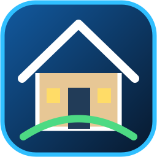

> **Image de référence :** le rendu réaliste validé reste la direction artistique. Le modèle WebGL actuel est une maquette 3D interactive qui ne reproduit pas encore cette fidélité visuelle. Une affiche de présentation est en cours de préparation pour le README.

# Maison 3D V2.0 — Home Assistant

Intégration Home Assistant avec panneau 3D interactif et éditeur d'implantation.

## Installation
1. HACS → Dépôts personnalisés → `https://github.com/XAV59213/maison3d` → **Intégration**.
2. Télécharger, puis redémarrer Home Assistant.
3. Paramètres → Appareils et services → Ajouter une intégration → **Maison 3D**.
4. Ouvrir **Maison 3D** dans la barre latérale.

## Référence retenue
La **dernière image validée le 14 novembre 2026** est la référence visuelle. La scène éditable est une maquette technique et ne reproduit pas encore photoréalistiquement cette image. Les positions et dimensions restent ajustables et approximatives.

Disposition : grange indépendante sur la gauche de la maison, rampe automobile côté gauche vers le stationnement, abri métallique au premier plan, garage à l'extrême droite, balançoire dans le jardin vers la piscine ; murets et paliers pour le dénivelé ; portail coulissant et portillon indépendant.

## Édition
Sélectionner un objet pour modifier sa position X/Z, ses dimensions, son orientation, le dupliquer ou le supprimer. Ajout de nouveaux objets avec l'outil **Ajouter**. Export/import JSON. La sauvegarde automatique utilise le stockage local du navigateur ; pensez à exporter une copie.

## Limites
- Three.js est chargé depuis un CDN, accès Internet requis.
- Aucune commande d'entité Home Assistant (portail, lumière, volets) n'est activée pour le moment.
- La météo affichée n'est pas une prévision réelle.
- La photo de référence n'est pas un mesh 3D : le rendu est un modèle interactif distinct.

## Installation manuelle
Copier `custom_components/maison3d` dans `/config/custom_components/maison3d`, redémarrer, ajouter l'intégration.

## Identité graphique

- Logo vectoriel : [assets/logo.svg](assets/logo.svg)
- Icône vectorielle : [assets/icon.svg](assets/icon.svg)
- L'affiche de présentation jour/nuit et saisons reste illustrative : ne pas confondre avec les fonctionnalités réellement testées.

## Météo et soleil

Le panneau JavaScript relaie désormais les états de la première entité `weather.*` et de `sun.sun` vers la vue WebGL. L'animation des précipitations et feuilles, l'éclairage en fonction du soleil et la sélection explicite de l'entité météo doivent encore être intégrés et testés avant publication stable.
